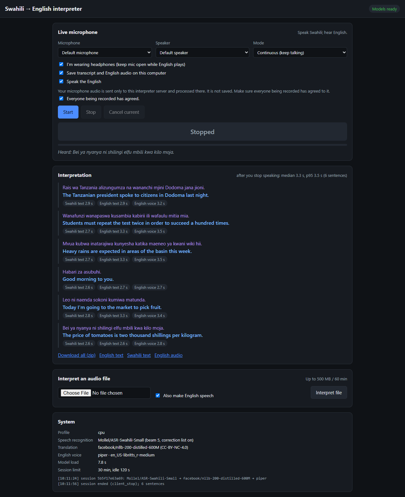
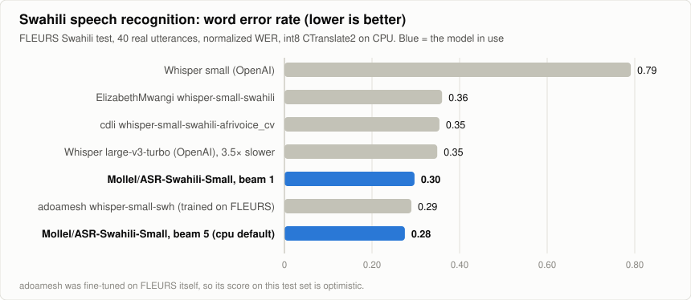
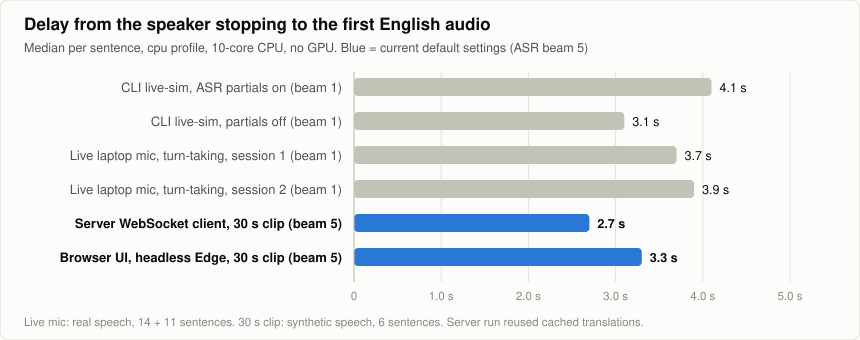
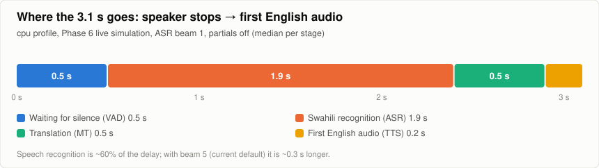
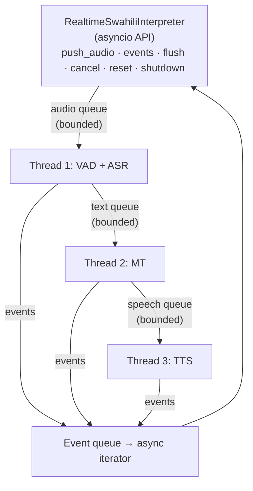
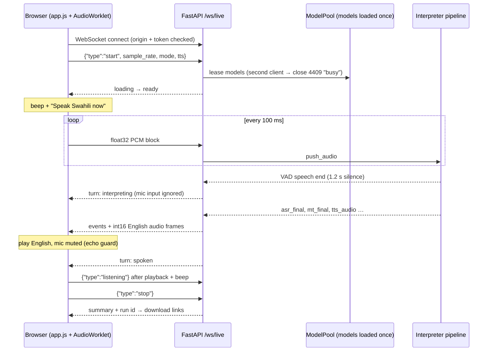
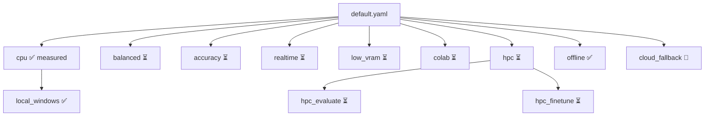
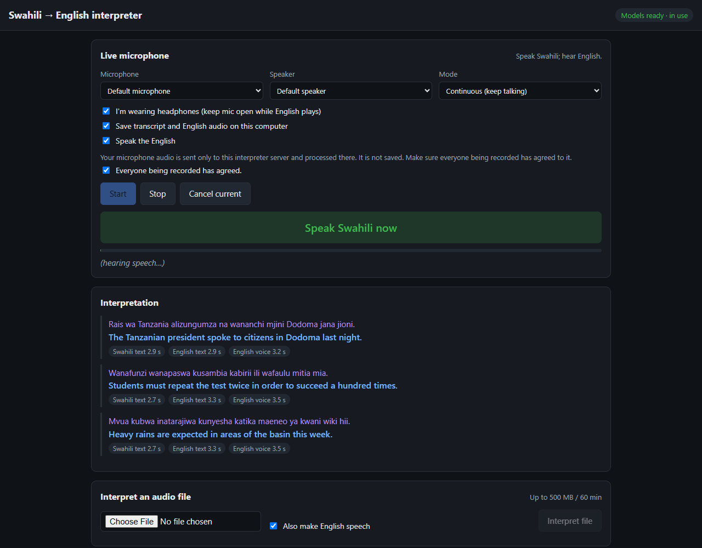

# Real-Time Swahili → English Interpreter

Speak Swahili into a microphone and hear English a few seconds later, running entirely on an
ordinary Windows PC with no GPU and no cloud services.

The system is a modular **cascade**: voice activity detection → streaming Swahili speech
recognition → text clean-up → neural machine translation → English speech synthesis. It runs
from the command line, from Python, and from a browser UI served by a local FastAPI server. One
codebase and a set of configuration profiles target a CPU-only PC, GPU PCs, Google Colab and
HPC clusters (the last three are not yet tested; see [Status](#status-completed-vs-ongoing)).



*The browser UI after a live session (screenshot from this repository's server; the
microphone input was a 30 s Swahili recording).*

---

## Contents

1. [The problem](#the-problem)
2. [Status: completed vs ongoing](#status-completed-vs-ongoing)
3. [Results at a glance](#results-at-a-glance)
4. [Architecture](#architecture)
5. [Methodology](#methodology)
6. [Technologies](#technologies)
7. [Quick start](#quick-start)
8. [Using the interpreter](#using-the-interpreter)
9. [Component details and measurements](#component-details-and-measurements)
10. [Configuration and profiles](#configuration-and-profiles)
11. [Privacy, security and licensing](#privacy-security-and-licensing)
12. [Limitations and known issues](#limitations-and-known-issues)
13. [Repository layout](#repository-layout)
14. [Testing](#testing)
15. [Roadmap](#roadmap)

---

## The problem

Swahili is spoken by an estimated 100 million or more people across East Africa, but real-time
speech-to-speech interpretation into English is not readily available for it, especially
offline or on modest hardware. The obstacles are concrete:

- **Speech recognition is the weak link.** General multilingual models handle Swahili poorly.
  On real Swahili speech (FLEURS), OpenAI Whisper `small` gets about 8 words in 10 wrong. Larger
  models are better but much slower than real time on a CPU.
- **Errors cascade.** A recognition error such as "elfumbili" (for "elfu mbili", *two thousand*)
  becomes a confident but wrong English sentence ("two shillings"). Translation quality is
  capped by recognition quality.
- **Latency is unforgiving.** A listener expects English within a few seconds of the speaker
  pausing, yet every stage (detecting the end of speech, recognising, translating, synthesising)
  adds delay.
- **Privacy and cost.** Many settings (meetings, clinics, interviews) can't send audio to a
  cloud service. The system should run fully offline, never store microphone audio, and make
  any cloud fallback an explicit opt-in.
- **Local details matter.** Swahili abbreviations (`Dkt.`, `Bw.`, `n.k.`), shilling amounts,
  and East African names all need care at each stage.

**Goal:** a transparent, measurable, offline interpreter. It should give understandable English
within about 3–4 seconds of the speaker pausing on a CPU-only PC, with every model choice
justified by a measurement. The full requirements are in
[REALTIME_SWAHILI_ENGLISH_SYSTEM.md](REALTIME_SWAHILI_ENGLISH_SYSTEM.md).

---

## Status: completed vs ongoing

The work is delivered in 12 phases. Each phase is verified with automated tests and, where
relevant, measured on the local CPU before the next one starts.

| Phase | Scope | Status |
|---|---|---|
| 0 | Repository scaffold, packaging, CI | ✅ Done |
| 1 | Config profiles, event tracing, logging, run manifests, platform diagnosis, CLI | ✅ Done |
| 2 | Audio I/O + voice activity detection (VAD) | ✅ Done |
| 3 | Streaming speech recognition (ASR) | ✅ Done |
| 4 | Text stabilization + machine translation (MT) | ✅ Done |
| 5 | Streaming speech synthesis (TTS) | ✅ Done |
| 6 | Async pipeline, Python API, batch/live CLI, turn-taking mode | ✅ Done |
| 7 | FastAPI/WebSocket server + browser UI | ✅ Done. Tested end to end in headless Edge with a recording as the microphone. A test with a real microphone in a browser is pending. |
| 8 | Systematic evaluation and benchmarks | ⏳ Planned. Some measurements already exist (below). |
| 9 | Google Colab notebooks | ⏳ Planned (config profile exists, not yet run) |
| 10 | HPC Slurm scripts + ASR fine-tuning | ⏳ Planned (config profiles exist, not yet run) |
| 11 | Documentation, Docker, release | ⏳ Planned |

**How to read the rest of this README:**

| Label | Meaning |
|---|---|
| ✅ **Completed** | Implemented, covered by tests, and used by the default `cpu` profile. |
| 🧪 **Experimental** | Implemented and available, but off by default or not yet proven to help. |
| ⏳ **Planned** | Designed in the spec and possibly scaffolded in configs, but not built or not run. |

| Feature | State |
|---|---|
| Offline CPU pipeline: Silero/WebRTC VAD → Swahili Whisper fine-tune → NLLB-600M → Piper | ✅ Completed |
| Live microphone, turn-taking mode with echo guard (CLI and browser) | ✅ Completed |
| Browser UI, WebSocket API, file upload, downloads, model pool, access control | ✅ Completed |
| ASR model selection on real Swahili speech (FLEURS) and beam-size choice | ✅ Completed |
| Export of transcripts, translations, events, English audio and manifest per run | ✅ Completed |
| ASR correction list (`configs/asr_corrections/sw.csv`) | 🧪 Experimental, on by default. Fixes only mistakes it has already seen. |
| Continuous ("simultaneous") mode | 🧪 Works, but needs headphones |
| ASR partial results and partial translation | 🧪 Off on CPU (adds about 1 s of delay); intended for GPU |
| Name pronunciation dictionary for English TTS | 🧪 Supported, not enabled (no measured gain) |
| Kokoro (local) and Edge (cloud) voices | 🧪 Opt-in (too slow on this CPU; Edge sends text to Microsoft) |
| GPU, Colab and HPC profiles (`balanced`, `accuracy`, `realtime`, `colab`, `hpc*`) | ⏳ Configured but **not measured** |
| Human ratings of translation and voice quality; larger real-speech benchmarks | ⏳ Phase 8 |
| Fine-tuning Swahili ASR on local data | ⏳ Phase 10 |
| Docker image, release packaging | ⏳ Phase 11 |

---

## Results at a glance

All numbers were measured on the development machine: **Windows 11, 10-core CPU, 16 GB RAM,
no GPU**, `cpu` profile, int8 inference. Each result names its test set and conditions. The
synthetic clips are machine-generated Swahili speech, which is useful for integration and
latency tests but easier than real speech.

| What | Result | Conditions |
|---|---|---|
| **End-to-end delay** (speaker stops → first English audio) | **2.7–3.3 s median** (server / browser), 3.7–3.9 s on a live laptop mic | 30 s synthetic clip streamed in real time; two live mic sessions with real speech (beam 1) |
| Live mic sessions | 25 sentences, 0 errors, 0 echo loops, 0 playback gaps; ~half translated correctly | One speaker, laptop mic, turn-taking mode |
| **Swahili ASR word error rate**, real speech | **0.275** (OpenAI Whisper small: 0.791) | FLEURS sw test, 40 utterances |
| Swahili ASR WER, synthetic speech | **0.021** (Whisper small: 0.734) | 10 unseen synthetic clips |
| **Translation quality** (text in) | **BLEU 42.0, chrF 64.2** | FLORES-200 devtest, 200 sentences, NLLB-600M int8 |
| Translation speed | 0.72 s median, 1.2 s p95 per sentence | same |
| **English TTS** first audio | 0.22 s median, real-time factor 0.06 | Piper libritts_r, 33 sentences |
| TTS intelligibility (Whisper round-trip WER) | 0.074 overall, 0.21 on names & numbers | same |
| Browser end-to-end test | 6 of 6 sentences correct on screen, no browser errors | Headless Edge, fake mic from a 30 s clip, continuous mode |
| Memory | ~1.55 GB RSS for the full pipeline | `cpu` profile |
| Automated tests | 167 passing (161 fast + 6 slow); ruff clean | `pytest` |







**What the results say:**

1. **The Swahili fine-tune was the biggest single win.** Switching from OpenAI Whisper `small`
   to `Mollel/ASR-Swahili-Small` (same size, same speed) cut real-speech WER from 0.79 to 0.30.
   Beam 5 took it to 0.275 for about 0.3 s more per sentence.
2. **Speech recognition is still the bottleneck,** both for quality (nearly all wrong
   translations in live sessions trace back to misheard Swahili) and for latency (about 60% of
   the delay).
3. **Translation is good when the input is good.** NLLB-600M reaches chrF 64 on clean text.
4. **The server and browser add no measurable delay** over the in-process pipeline.

The charts are generated by [scripts/make_readme_figures.py](scripts/make_readme_figures.py)
from the numbers in this README.

---

## Architecture

### Processing pipeline

```mermaid
flowchart LR
    subgraph IN["Audio input"]
        MIC["Microphone<br/>(CLI: sounddevice)"]
        BRW["Browser mic<br/>(AudioWorklet → WebSocket)"]
        FILE["Audio file<br/>(CLI or upload)"]
    end

    subgraph ASRW["Worker 1: listen"]
        RES["Resample to 16 kHz mono"] --> VAD["VAD<br/>Silero / WebRTC / energy"]
        VAD -->|"utterance"| ASR["Swahili ASR<br/>faster-whisper (CT2 int8)"]
        ASR --> FILT["Hallucination filter"]
        FILT --> CORR["ASR correction list"]
    end

    subgraph MTW["Worker 2: translate"]
        STAB["Stabilize text<br/>(spacing, punctuation)"] --> SENT["Swahili-aware<br/>sentence aggregation"]
        SENT --> MT["MT: NLLB-200 (CT2 int8)<br/>+ cache, guards, masking"]
    end

    subgraph TTSW["Worker 3: speak"]
        CHUNK["English chunking<br/>+ spoken form"] --> TTS["TTS: Piper<br/>(fallback SAPI)"]
        TTS --> NORM["Resample, trim,<br/>normalize, fade"]
    end

    IN --> RES
    CORR -->|"bounded queue"| STAB
    MT -->|"bounded queue"| CHUNK
    NORM --> OUT["Speaker / browser playback"]

    ASRW -. events .-> BUS(("Event stream"))
    MTW -. events .-> BUS
    TTSW -. events .-> BUS
    BUS --> UI["CLI output / browser UI"]
    BUS --> EXP["Run export:<br/>transcript, translation,<br/>units, events, manifest, English WAV"]
```



Each stage is a separate module behind a small interface (`src/vad`, `src/asr`, `src/text`,
`src/mt`, `src/tts`), so a model or backend can be swapped through configuration. Every
fallback is recorded rather than silent.

### Concurrency model



- **Pipelining.** ASR decodes the next utterance while the previous one is translated and
  spoken.
- **Back-pressure.** Bounded queues slow the producer instead of growing memory.
  `push_audio(block=False)` drops and counts audio instead of blocking.
- **Fault isolation.** A failed decode loses only its own segment. A TTS failure still
  delivers the text. `health()` reports `degraded`.
- **Traceability.** Every translation unit ends with a `pipeline_complete` event carrying its
  per-stage latencies.

### Server and browser (live session, turn-taking mode)



### Configuration profiles



---

## Methodology

**Build order.** The system is built in phases, from the inside out: configuration and
tracing first, then each pipeline stage in order, then the async pipeline, then the server.
Each phase ends with tests and a measurement on the target CPU, and the default configuration
changes only when a measurement supports it. For example, the `cpu` profile's ASR model, beam
size, partials setting, MT model and voice were each chosen from a measured comparison. Those
comparisons are recorded below and as comments in `configs/cpu.yaml`.

**Design principles:**
- **Measure, don't assume.** Model IDs in configs are candidates until benchmarked, and the
  Hugging Face commit of each model is recorded in every run manifest.
- **No silent fallbacks.** CUDA→CPU, model→fallback model and voice changes all emit events
  and appear in the manifest. `fallback.policy=fail` makes them errors.
- **Never invent content.** Filters remove or flag text and never fill gaps. Stabilization
  changes only spacing, punctuation and case. Only final translations are spoken, because
  spoken audio can't be retracted.
- **Privacy by default.** Offline models; cloud backends require explicit opt-in and are
  refused for restricted data; microphone audio is never written to disk.

**Evaluation data:**

| Data | Use | Notes |
|---|---|---|
| [FLEURS](https://huggingface.co/datasets/google/fleurs) Swahili test (`scripts/fetch_fleurs_sw.py`) | ASR model selection on **real** speech | CC-BY-4.0; 40 utterances so far |
| [FLORES-200](https://github.com/facebookresearch/flores) devtest (`scripts/fetch_flores200.py`) | MT quality with **human** references | First 200 sentences |
| Synthetic Swahili (`scripts/make_synthetic_swahili.py`) | Integration, latency, regression | Edge-TTS voices with known text; easier than real speech |
| Live laptop-microphone sessions | End-to-end behaviour with a real speaker | One speaker, 25 sentences; judged by hand |
| English TTS sentence set | Voice speed and intelligibility | 8 sentences with names and numbers + 25 FLORES references |

**Metrics:**
- **ASR:** word error rate (WER) and character error rate (CER) after normalization (`jiwer`).
- **MT:** BLEU, chrF and chrF++ (`sacrebleu`, with signatures saved).
- **TTS intelligibility:** a Whisper round trip. The speech is transcribed and scored against
  the input text. This is a proxy, not a listening test.
- **Latency:** each unit is timed from the **last speech frame**, the moment a listener starts
  waiting. Results are reported as median (p50) and p95 per stage and to first English audio.
  Latencies from batch runs include backlog and are labelled as such, never reported as
  listener latency.
- **Resources:** RSS memory and real-time factor (RTF, processing time ÷ audio duration).

**Live-pace testing.** `--live-sim` and the WebSocket and browser tests feed recorded audio
at real-time pace (100 ms blocks), so latency figures reflect a speaker talking rather than
a file being processed as fast as possible.

---

## Technologies

| Layer | Technology | Why |
|---|---|---|
| Language / runtime | Python 3.10+, `asyncio`, worker threads | Async API with stages running in parallel on CPU |
| Configuration | YAML profiles with inheritance, Pydantic schema, env/CLI overrides | One codebase for PC, GPU, Colab and HPC |
| Audio I/O | `sounddevice`, `soundfile`, `soxr` | Capture, file decoding, high-quality resampling |
| VAD | Silero VAD v5 via `onnxruntime` (no PyTorch), `webrtcvad`, energy fallback | Accurate or fast options; no torch needed on CPU |
| ASR | `faster-whisper` / CTranslate2 int8; **Mollel/ASR-Swahili-Small** (Whisper-small Swahili fine-tune) | Best Swahili accuracy that keeps up in real time on CPU |
| MT | CTranslate2 int8; **NLLB-200-distilled-600M**; Marian `opus-mt-swc-en` fallback; `transformers` reference engine | Highest chrF at sub-second latency |
| TTS | **Piper** (`en_US-libritts_r-medium`), Windows SAPI fallback; Kokoro, MMS, Edge optional | ~0.2 s to first audio, fully local |
| Server | FastAPI, Uvicorn, WebSockets, `python-multipart` | Live streaming API and browser UI |
| Browser UI | Plain HTML/CSS/JS, AudioWorklet capture, Web Audio playback, `setSinkId` speaker choice | No build step or framework |
| Evaluation | `jiwer`, `sacrebleu`, `datasets`, `pandas` | Standard ASR/MT metrics |
| Quality | `pytest` (+ asyncio), `ruff`, GitHub Actions (Ubuntu + Windows, Python 3.10/3.11) | Lightweight CI with no model downloads |

---

## Quick start

**Requirements:** Python 3.10+; 16 GB RAM recommended; several GB of disk for models; a
microphone for live use. No GPU is needed. Developed and measured on Windows 11. CI also runs
the tests on Ubuntu.

```powershell
py -3.10 -m venv .venv
Set-ExecutionPolicy -Scope Process Bypass
.\.venv\Scripts\Activate.ps1
python -m pip install --upgrade pip
pip install -e ".[dev,audio,local,asr,mt,tts,ui,torch]"   # torch: only for the one-time model conversion

python -m src.cli diagnose                 # hardware, libraries, devices
python -m src.cli serve --profile cpu --open    # browser UI at http://127.0.0.1:8000
```

Models download on first use into `cache/`. On some Windows networks Hugging Face downloads
stall; setting `HF_HUB_DISABLE_XET=1` fixes this. Once models are cached, `HF_HUB_OFFLINE=1`
runs fully offline.

**In the browser:**
1. Choose the microphone and speaker.
2. Tick the consent box and click **Start**.
3. When you hear a beep and see **Speak Swahili now**, say a sentence and pause.
4. The English is spoken, then a beep marks your turn.
5. Click **Stop** for download links.



---

## Using the interpreter

### Command line

```powershell
# Live microphone, turn-taking mode (beep → speak → pause → hear English)
python -m src.cli interpret --mic --seconds 180 --play --profile cpu

# A recording, paced like a live speaker, played to the speaker
python -m src.cli interpret --input audio.wav --profile cpu --live-sim --play

# Batch: text only, plus a run directory with all results
python -m src.cli interpret --input audio.wav --no-tts --export

# Single stages
python -m src.cli devices                                      # list microphones / speakers
python -m src.cli vad --input clip.wav --profile cpu           # speech segments
python -m src.cli transcribe --input clip.wav --profile cpu    # Swahili text
python -m src.cli translate --text "Habari za asubuhi." --profile cpu
python -m src.cli speak --text "Good morning." --output out.wav --profile cpu
```

`--export` writes `transcript_sw.txt`, `translation_en.txt`, `units.jsonl`, `speech_en.wav`,
`events.jsonl/.csv` and `manifest.json` to a run directory. **Microphone audio is never
saved.** Only text, events and the English speech are.

### Python API

```python
from src.pipeline import RealtimeSwahiliInterpreter

async with RealtimeSwahiliInterpreter("cpu") as interp:       # start() ... shutdown()
    await interp.push_audio(chunk, sample_rate=16000)          # float32 or int16, any rate, mono/stereo
    async for event in interp.events():
        if event.type == "asr_final":  print("Swahili:", event.text)
        if event.type == "mt_final":   print("English:", event.text)
        if event.type == "tts_audio":  play(event.audio, event.data["sample_rate"])
```

The API also offers:

| Method | What it does |
|---|---|
| `flush()` | End the utterance and wait until it is spoken |
| `cancel()` | Drop queued work; stop speaking at the next chunk |
| `reset()` | Cancel and forget context |
| `status()`, `health()`, `model_status()` | Current state, health and loaded models |
| `units()`, `summary()` | Results so far |
| `shutdown()` | Stop the pipeline |

### HTTP / WebSocket API

The browser uses only this API, so other clients can too:

| Endpoint | Purpose |
|---|---|
| `GET /api/health`, `GET /api/status` | Model state, limits, live queues |
| `WS /ws/live` | Live session. Client sends JSON control messages and float32 PCM. Server sends events, turn messages and int16 English audio. Protocol in [src/server/live.py](src/server/live.py). |
| `POST /api/interpret` | Multipart audio file → Swahili, English, per-sentence latencies, run id |
| `GET /api/runs/{run_id}/{file}` | `export.zip`, `speech_en.wav`, `translation_en.txt`, `transcript_sw.txt`, `units.jsonl`, `events.*`, `manifest.json` |

### Live modes

| Mode | Behaviour | Use |
|---|---|---|
| **Turn-taking** (`consecutive`, default) | A spoken cue and beep start each turn. 1.2 s of silence ends it. The mic is muted while the English plays, then a beep means "your turn". | Laptop speakers; most reliable |
| **Continuous** (`simultaneous`) | Keeps listening while English plays | Headphones only, otherwise the interpreter hears itself |

---

## Component details and measurements

<details>
<summary><b>Audio and VAD (Phase 2)</b> ✅</summary>

| Backend | Notes |
|---|---|
| `silero` | Silero v5.1.2 through onnxruntime, no PyTorch. Downloaded once to `cache/models/`, SHA-256 verified. MIT. |
| `webrtc` | Binary decisions; very fast (cpu profile default). |
| `energy` | Dependency-free last resort. |

If a backend can't load, the next one in the chain `silero → webrtc → energy` is used, and the
fallback is recorded.

How segmentation works:
- The segmenter keeps `speech_pad_ms` of audio before speech onset.
- A segment opens only after `min_speech_ms` of continuous speech.
- A segment closes after `min_silence_ms` of silence and keeps `hangover_ms` after the last
  speech frame.
- Utterances longer than `max_utterance_s` are split.
- Timestamps are counted in samples, so results don't depend on how the audio is chunked.

</details>

<details>
<summary><b>Speech recognition (Phase 3, model choice in Phase 6)</b> ✅</summary>

**Engine.** faster-whisper (CTranslate2) with the language forced to `sw`.
- Download, load, cold decode and warm decodes are timed separately.
- The Hugging Face snapshot commit is recorded in every manifest.
- Any Hugging Face Whisper checkpoint can be used as `asr.model`. It is converted once to
  CTranslate2 in `cache/ct2/asr/` (with `provenance.json`) by
  [src/asr/convert.py](src/asr/convert.py).

**Streaming.**
- Partials come from greedy re-decodes about every `asr.chunk_s` seconds.
- A word prefix is committed once `asr.stable_prefix_agreement` consecutive hypotheses agree.
- Committed text never shrinks.
- The final result is a beam-search decode when VAD closes the utterance.
- On slow hardware, partials thin out automatically instead of building a backlog.

**Hallucination policy.** The filter removes or flags text and never fills gaps:

| Reason | Trigger |
|---|---|
| `empty` | No text |
| `no_speech` | High no-speech probability and low confidence |
| `repetition_loop` | Compression ratio too high |
| `hallucination_phrase` | Known subtitle/outro phrase, e.g. "Asante kwa kutazama" |
| `duplicate_segment` | Repeats the previous utterance |
| `very_low_confidence` | Average log-probability far below the threshold |

**Model comparison.** Measured with `scripts/asr_eval_fleurs.py` at beam 1, int8, normalized WER:

| Model | FLEURS sw test (40 real utterances) | Synthetic (10 unseen clips) | Decode p50 |
|---|---|---|---|
| Whisper `small` (OpenAI) | 0.791 | 0.734 | ~2.3 s |
| **Mollel/ASR-Swahili-Small (cpu default, Apache-2.0)** | **0.297** | **0.053** | ~2.3 s |
| cdli/whisper-small-swahili-afrivoice_cv (fallback) | 0.354 | 0.170 | ~2.3 s |
| ElizabethMwangi/whisper-small-swahili-afrivoice-cv | 0.360 | 0.138 | ~2.3 s |
| adoamesh/whisper-small-swh-finetuned (trained on FLEURS) | 0.290 | 0.192 | ~2.3 s |
| large-v3-turbo (OpenAI) | 0.349 | – | ~8.1 s |

**Beam size.** Beam 5 (cpu default since 2026-11-23) gives FLEURS WER 0.275 and synthetic WER
0.021, against 0.297 / 0.053 at beam 1. Each decode is about 0.3 s slower (p50 3.3 s vs
3.0 s). Use `--set asr.beam_size=1` for lower latency.

**Earlier smoke test with OpenAI models** (synthetic set; this is why a Swahili fine-tune
was needed):

| Model | WER | CER | p50 decode | RTF | RSS |
|---|---|---|---|---|---|
| base | 0.936 | 0.187 | 719 ms | 0.14 | 195 MB |
| small | 0.723 | 0.132 | 2395 ms | 0.49 | 351 MB |
| medium | 0.415 | 0.076 | 6120 ms | 1.24 | 900 MB |
| large-v3-turbo | 0.117 | 0.026 | 8555 ms | 1.74 | 990 MB |

Notes:
- Fine-tunes with a custom vocabulary (e.g. alphaedge-ai) don't work with faster-whisper,
  which treats them as English-only.
- On Windows without Developer Mode the Hugging Face cache can fail with WinError 1314
  (symlinks). The converter falls back to a plain-copy download folder.

</details>

<details>
<summary><b>ASR correction list</b> 🧪</summary>

[configs/asr_corrections/sw.csv](configs/asr_corrections/sw.csv) holds `heard,correct` pairs
(29 entries) that rewrite recurring mishearings in the Swahili transcript before translation.
Examples: "mwenye kiti" → "mwenyekiti", "madam barimbali" → "mambo mbalimbali".

- **Matching:** whole-word, case-insensitive, longest entry first.
- **Traceability:** the uncorrected text is kept in the `asr_final` event as `original`
  (dropped when `logging.log_text=false`).
- **Turning it off:** set `asr.corrections_path: null`.

**Why it is experimental:**
- Applied to the session it was built from, it turned "A gentleman with a chair" into
  "Mr. Chairman".
- On a new session it made 0 corrections. It only fixes mistakes it has already seen.
- Add an entry only after the same mistake appears more than once, and prefer phrases to
  single words.

</details>

<details>
<summary><b>Text stabilization and translation (Phase 4)</b> ✅</summary>

**Path from ASR to English:** stabilization → Swahili-aware sentence aggregation → MT.

- **Stabilization** changes only spacing, punctuation, case and runaway repeats, and lists
  every change.
- **Sentence aggregation:**
  - Abbreviations (`Dkt.`, `Bw.`, `n.k.`) don't end a sentence.
  - After a max-duration split, the unfinished tail is held until the sentence completes.
  - Run-on speech is broken at a clause boundary after `text.max_sentence_words`.

**Engines.**
- **CTranslate2 int8** (default). The model is converted once into `cache/ct2/` with
  `provenance.json`.
- **transformers.** The reference engine.

**Safeguards:**
- An LRU cache.
- Opt-in partial translation of only the committed ASR prefix.
- An uncertain-transcript policy.
- Output guards: `length_ratio`, `repeat_collapsed`, `empty_output`.
- Preservation checks for numbers, acronyms and glossary terms.
- With `--mask`, numbers and glossary terms become placeholders (`Z1Q`). If a placeholder is
  dropped, the sentence is re-translated unmasked.

**Measured on the local CPU.** FLORES-200 devtest, first 200 sentences, human references,
CT2 int8, beam 2, batch 1:

| Model | License | BLEU | chrF | chrF++ | p50 | p95 | Numbers kept | RAM |
|---|---|---|---|---|---|---|---|---|
| **nllb-200-distilled-600M** | CC-BY-NC-4.0 | **42.0** | **64.2** | 62.9 | 719 ms | 1201 ms | 91% | ~845 MB |
| nllb-600M + 1 sentence of context | | 40.8 | 62.9 | 61.5 | 1720 ms | 2900 ms | 87% | |
| opus-mt-swc-en | Apache-2.0 | 21.8 | 46.5 | 45.1 | 116 ms | 201 ms | 81% | ~130 MB |

- `opus-mt-swc-en` is trained on *Congo* Swahili: "Dodoma" became "Dodama", and "shilingi"
  became "pounds". It is kept only as a fallback.
- Context prefixing lowered scores and doubled latency, so `mt.context_mode` defaults to
  `none`.
- Preservation of names is reported but not flagged. Swahili capitalizes common nouns
  ("Kamati" → "Committee"), so a name flag fired on 44% of sentences.

</details>

<details>
<summary><b>Speech synthesis (Phase 5)</b> ✅</summary>

Only *final* translations are spoken. Before synthesis:
- **Chunking:** text is split at sentence ends ("Dr." and "U.S." don't break it). The first
  chunk may end at an early clause boundary so audio starts sooner.
- **Spoken form:** "CCM" → "C C M"; "TSh 2,000" → "2,000 Tanzanian shillings"; "%" →
  "percent".

After synthesis:
- **Consistent output:** every backend's audio is resampled to `tts.sample_rate`, trimmed,
  normalized to -20 dBFS RMS (-1 dBFS peak) and faded at chunk edges.
- **Validation:** each chunk is checked for empty, clipped, too-quiet or wrong-length audio.
- **Failures:** retries, then a fallback backend, recorded as a `fallback` event.

| Backend | Runs | License (engine / voice) |
|---|---|---|
| `piper` | local | GPL-3.0 engine / default voice `en_US-libritts_r-medium` CC BY 4.0 (attribution required) |
| `sapi` | local, Windows | Windows built-in voices |
| `kokoro` | local | Apache-2.0; files SHA-256 pinned |
| `mms` | local | CC-BY-NC-4.0 |
| `edge` | **cloud** | Microsoft terms; needs `fallback.allow_cloud` and a non-restricted data class |

**Measured on the local CPU.** 33 sentences. Intelligibility is a Whisper `small` round trip,
a proxy rather than a listening test:

| Voice | First audio p50 / p95 / p99 | RTF | Round-trip WER (all / names & numbers) | RAM |
|---|---|---|---|---|
| **piper libritts_r (default)** | 218 / 452 / 504 ms | 0.063 | 0.074 / 0.210 | ~360 MB |
| piper lessac | 235 / 520 / 679 ms | 0.061 | 0.071 / 0.145 | ~400 MB |
| piper joe (CC0) | 278 / 522 / 603 ms | 0.064 | 0.092 / 0.237 | ~410 MB |
| sapi (Windows) | 35 / 57 / 66 ms | 0.006 | 0.056 / 0.105 | ~30 MB |
| kokoro af_heart (int8) | 6785 / 13119 / 17558 ms | 1.468 | 0.051 / 0.092 | ~510 MB |
| edge en-TZ-Imani (cloud) | ~2.6–3.1 s per chunk | ~1.7 | not measured | – |

- lessac is slightly more intelligible, but its dataset license is restricted.
- **East African names are the weak spot for every English voice.** "Suluhu Hassan" was heard
  as "Salu hasn't".
- 🧪 A pronunciation dictionary (`configs/pronunciation/sw_names_en.yaml`) is supported but
  **not enabled**. The round trip showed no consistent gain.

</details>

<details>
<summary><b>Async pipeline and live sessions (Phase 6)</b> ✅</summary>

**Measured on the local CPU.** `cpu` profile, `--live-sim`, 30 s synthetic clip, 6
utterances, beam 1. Latency is from the last speech frame:

| ASR partials | ASR final | MT final | First English audio p50 / p95 | RAM |
|---|---|---|---|---|
| on | 3.4 s | 4.0 s | 4.1 / 5.2 s | ~1.55 GB |
| **off (cpu default)** | 2.4 s | 2.8 s | **3.1 / 3.3 s** | ~1.55 GB |

Partials are off on CPU. Each one is another ~2 s decode, and the final decode waits behind
it. Set `--set asr.partials=true` on a GPU.

**Live laptop-mic sessions** (2026-11-23, turn-taking mode, beam 1, one speaker, 14 + 11
sentences):
- **Delay:** English started a median of 3.7 s and 3.9 s after the speaker stopped (range
  3.2–5.0 s).
- **Reliability:** no errors, no echo, no playback gaps.
- **Accuracy:** about half the sentences were translated correctly. Nearly all errors came from
  ASR: split or misheard formal words ("mwenye kiti" for "mwenyekiti") and names. This led to
  beam 5 and the correction list.

</details>

<details>
<summary><b>Web server and browser UI (Phase 7)</b> ✅</summary>

**Model pool.** Models are loaded once per server, in the background at startup (7.8 s on this
PC), and lent to one session at a time. A second tab or upload gets "busy" (HTTP 409 /
WebSocket close 4409) rather than slowing the first.

**Browser.**
- Capture uses an AudioWorklet that sends 100 ms blocks.
- The echo guard mutes the mic while English plays, unless headphones are ticked.
- The speaker can be chosen with `setSinkId` where the browser supports it.
- Beeps mark each turn.

**Measured on the local CPU** (cpu profile, beam 5, 30 s synthetic clip streamed at
real-time pace):

| Client | First English audio after each sentence | Sentences | Errors |
|---|---|---|---|
| Python WebSocket client, continuous mode | median 2.7 s, p95 3.0 s | 6 / 6 | 0 |
| Headless Edge, page UI, clip as fake microphone, continuous mode | median 3.3 s, p95 3.5 s | 6 / 6 | 0 browser errors |
| CLI `--live-sim` (reference) | median 3.6 s | 6 / 6 | 0 |

- The WebSocket run benefited from the translator cache (same sentences seen earlier). The
  server itself adds no measurable delay.
- In turn-taking mode, audio that arrives while the English is being produced is ignored by
  design. A speaker who doesn't wait for the beep loses the start of the next sentence.
- **Still to do:** a test with a real microphone and speakers in a real browser window
  (speaker selection, beeps, echo guard).

</details>

---

## Configuration and profiles

Profiles live in [configs/](configs/) and inherit through `inherits:`. Precedence, highest
first:

1. CLI: `--set asr.beam_size=3` (repeatable)
2. Environment: `SWI__ASR__BEAM_SIZE=3`, plus `SWI_PROFILE`, `SWI_DEVICE`, `SWI_PLATFORM`
3. Profile YAML chain
4. Auto-detection (`device: auto` → CUDA if available, else CPU)

```powershell
python -m src.cli config list
python -m src.cli config show --profile cpu --resolve
```

| Profile | Target | State |
|---|---|---|
| `cpu` / `local_windows` | CPU-only PC; Windows mic capture | ✅ Measured; all results above |
| `offline` | No external calls; restricted data | ✅ |
| `realtime`, `balanced`, `accuracy`, `low_vram` | GPU PCs (larger ASR/MT models) | ⏳ Not measured; no GPU available yet |
| `colab` | Google Colab GPU, Drive cache | ⏳ Phase 9 |
| `hpc`, `hpc_evaluate`, `hpc_finetune` | Slurm clusters | ⏳ Phase 10 |
| `cloud_fallback` | Allows cloud TTS/MT/ASR for public data | 🧪 Opt-in |

Fallbacks such as CUDA→CPU or bf16→fp16 are never silent. Each one goes into the run manifest.
The config validator refuses:
- cloud backends when `privacy.data_class` is `restricted` or `private`
- cloud backends unless `fallback.allow_cloud` is set
- voice cloning

---

## Privacy, security and licensing

**Privacy:**
- **No audio is kept.** Microphone audio is never written to disk. An uploaded file is kept in
  a temporary folder only while it is interpreted.
- **Text logging can be switched off.** With `logging.log_text=false`, no text is written to
  logs or exports.
- **Offline by default.** Cloud backends need `fallback.allow_cloud` and a non-restricted data
  class.

**Server security:**
- **Network access.** The server binds to `127.0.0.1`. With any other `--host`, every request
  needs a token from `SWI_SERVER_TOKEN`, sent as `Authorization: Bearer …` or `?token=`. If
  none is set, one is generated and the link is printed. The token is never read from the
  command line.
- **Origin check.** Browser requests from other sites are refused (HTTP 403 / close 4403).
- **Limits.** Requests are rate-limited per client. Sessions end after 30 min or after 2 min
  without data. Uploads are limited by size and duration.
- **Downloads.** Only runs created by the current server process can be downloaded.
- **Headers.** Responses carry a strict Content-Security-Policy, `X-Frame-Options: DENY` and
  `no-store` caching.
- **Remote use.** Browsers allow the microphone only on `https://` or `localhost`. Forward the
  port over SSH (`ssh -L 8000:127.0.0.1:8000 host`) rather than exposing it.

**Licensing:**
- **This project's code:** Apache-2.0 (as declared in `pyproject.toml`).
- ⚠️ **The default translation model NLLB-200 is CC-BY-NC-4.0, non-commercial only.** For
  commercial use, switch `mt.model` to an Apache/MIT model such as `opus-mt-swc-en` (lower
  quality, see above).
- **ASR model:** Mollel/ASR-Swahili-Small is Apache-2.0.
- **Voice:** the Piper voice `libritts_r` is CC BY 4.0 and requires attribution. The Piper
  engine is GPL-3.0.
- **Data:** FLEURS is CC-BY-4.0.

---

## Limitations and known issues

- **Swahili ASR accuracy.**
  - Real-speech WER is about 0.28: roughly one word in four is wrong on FLEURS, and in live
    sessions about half the sentences came out fully right.
  - Formal vocabulary, compound words and names are the main failure modes.
  - This is the top priority for Phase 8 (measurement) and Phase 10 (fine-tuning).
- **Delay.** About 3–4 s from the speaker stopping to English. 1.2 s of that, in turn-taking
  mode, is the silence needed to decide the turn has ended.
- **Small and partly synthetic test sets.** 40 FLEURS utterances, a 30 s synthetic clip, and 25
  live sentences from one speaker. Results will move with larger, more varied data.
- **No human quality ratings yet.** Translation adequacy and voice naturalness have not been
  rated by Swahili/English speakers.
- **Names.** Every English voice mispronounces East African names.
- **One session at a time per server.** That is a deliberate trade-off for a single CPU.
- **Untested hardware.** GPU, Colab and HPC profiles have not been run.

---

## Repository layout

```
configs/                 YAML profiles, ASR correction list, pronunciation dictionary
src/
  config/                schema (Pydantic), profile loading and overrides
  audio/  capture/       file and microphone input, resampling, inspection
  vad/                   Silero (onnx), WebRTC, energy; utterance segmenter
  asr/                   faster-whisper streaming transcriber, filters, corrections, converter
  text/                  stabilization, Swahili sentence aggregation
  mt/                    CTranslate2 / transformers translators, guards, masking, cache
  tts/                   Piper, SAPI, Kokoro, MMS, Edge backends; chunking, spoken form
  pipeline/              RealtimeSwahiliInterpreter (async API), events, export
  server/                FastAPI app, WebSocket live session, model pool, security, static UI
  eval/                  metrics
  platform/  utils/      diagnosis, storage paths, logging, manifests, stats
  cli/                   `python -m src.cli …` commands
scripts/                 data fetchers, model comparisons, MT/TTS evaluation, README figures
tests/                   pytest suite (SAPI-synthesized speech fixtures on Windows)
docs/images/             screenshots and result charts used in this README
REALTIME_SWAHILI_ENGLISH_SYSTEM.md   full system specification
```

---

## Testing

```powershell
pytest -m "not slow and not gpu"     # 161 fast tests: config, audio, VAD, ASR, MT, TTS, pipeline, server
pytest                               # all 167, including slow tests that load real models
ruff check src tests
```

- **Model-free tests.** Most tests use scripted fakes for VAD/ASR/MT/TTS, so they run in
  seconds without downloading models.
- **Server tests.** These cover token, origin and rate limits, WebSocket protocol errors,
  turn-taking, cancel, busy handling, upload limits, temp-file cleanup and downloads.
- **CI.** GitHub Actions runs lint and tests on Ubuntu and Windows with Python 3.10 and 3.11.
- **Measurement scripts.** The figures in this README come from `scripts/asr_eval_fleurs.py`,
  `scripts/mt_eval.py`, `scripts/tts_eval.py` and the `--live-sim` / `--export` run
  directories.

---

## Roadmap

| Next | What | Why |
|---|---|---|
| Phase 7 close-out | Real-mic test in Chrome/Edge (speaker choice, beeps, echo guard) | Only headless-tested so far |
| **Phase 8** | Larger FLEURS / Common Voice ASR benchmark, end-to-end speech-to-speech BLEU/chrF, human ratings, latency under load | Replace small-sample numbers with solid ones |
| **Phase 9** | Colab notebooks for GPU runs | Measure the `realtime` / `accuracy` profiles |
| **Phase 10** | Slurm scripts; fine-tune Swahili Whisper on local/domain speech (e.g. meetings, names) | ASR is the bottleneck for quality |
| **Phase 11** | Docker image, docs, release | Easy installation |
